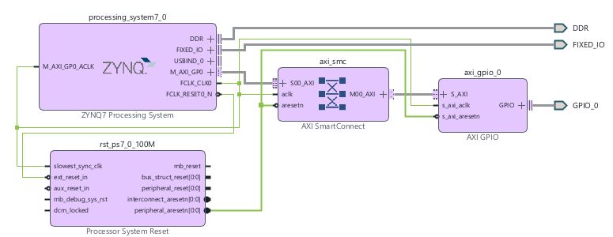
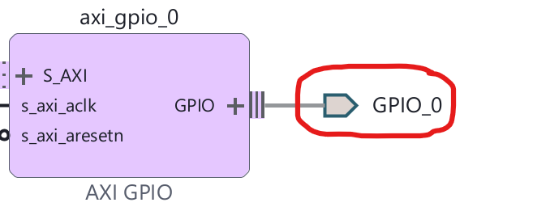
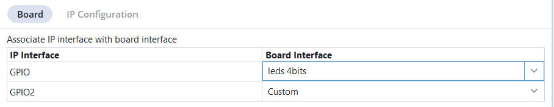
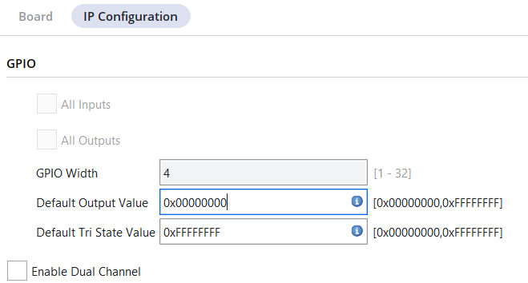
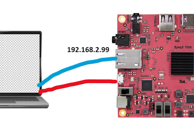

# LedOn

Dùng mã Python điều khiển đèn 4 Led bật tắt.

## Các thành phần

1. **Artix-7 Core:** Cấu hình FPGA trên Vivado để tạo khối **AXI GPIO** điều khiển LED.\
  _Lưu ý: Dự án sử dụng cấu hình mặc định trong PYNQ-Z2 board file. Vì vậy các chân PIN của 4 Led không được đính nghĩa chiều dữ liệu ra hay vào, và buộc phải thiết lập bằng mã Python._. [Xem ở đây](#artix-7-core---ip-core)
  
2. **Arm Core**: Lập trình Python để gửi giá trị phù hợp tới địa chỉ MMIO của **AXI GPIO**. [Xem ở đây](#arm-core---mã-python)

## Artix-7 Core - IP Core

  - File thiết kế dạng block diagram [mainsystem.bd](./LedOn.srcs/sources_1/bd/mainsystem/mainsystem.bd) (như trong ảnh) sẽ được biên dịch thành Verilog [mainsystem_wrapper.v](./LedOn.gen/sources_1/bd/mainsystem/hdl/mainsystem_wrapper.v) \
  \

  - Có nhiều  khối, đều là mặc định, để phần ARM Core có thể giao tiếp qua AXI4 tới các module ngoại vi. Điểm lưu ý là khai báo sử dụng các chân GPIO. 
    \
    
  - Chi tiết cấu trúc, Properties, của các chân GPIO như sau:\
    - _leds 4 bits_ là tên mặc định có sẵn khi chỉ định loại Dev Kit là TUL PYNQ Z2.
    \
    - Do sử dụng tên mặc định của board đã khai báo sẵn, nên không thể thiết lập cố định các GPIO này là Input hay Output, mà phải qua code cấu hình phía Arm core.\
    \

## ARM Core - Mã Python 

- [Mã nguồn để chạy web Jupiter trên phần Arm Core, kết nối tới phần IP core điều khiển led](./LedOn.ipynb)
- [Mã nguồn Python để chạy cmd trên phần Arm Core, kết nối tới phần IP core điều khiển led](./LedOn.py)
  ```python
  from pynq import Overlay
  import sys

  # Nạp Overlay
  ol = Overlay("./LedOn.bit")
  leds = ol.axi_gpio_0

  # Ép hướng thành Output (Ghi vào thanh ghi TRI tại offset 0x04)
  leds.mmio.write(0x04, 0x0)

  # Lấy giá trị từ tham số dòng lệnh (ví dụ: python3 control_led.py 15)
  value = int(sys.argv[1]) if len(sys.argv) > 1 else 0

  # Ghi dữ liệu
  leds.write(0, value)
  print(f"✅ Đã ghi giá trị {value} vào LED!")
  ```

## Artix-7 Core - Biên dịch và nạp kit

- Biên dịch: Click **Generate Bitstream**
- Kết nôi:
  - Cắm dây USB Micro vào Dev-Kit để cấp nguồn
  - Căm dây mạng RJ45 giữa Dev-Kit và máy tính\
  
- Nạp kit: Chạy script **CollectBitStream.py**. _(Hiệu chỉnh địa chỉ IP của dev kit nếu cần)_
- Truy cập vào phần ARM Core thông qua SSH (Arm core đã có sẵn ubuntu).
  ```shell
  ssh -t xilinx@192.168.2.99 "cd /home/xilinx/LedOn && bash -l"
  ```
  và chạy lệnh mẫu trên arm core
  ```shell
  ./runme.sh
  ```
- Hãy xem file runme.sh, và tự tùy chỉnh tham số dòng lệnh để đèn led tắt bật đúng như mong đợi.
